# Re:Work

<p align="center">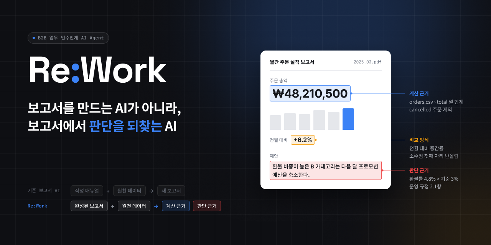</p>

**Re:Work**는 완성된 보고서(PDF)와 원천 데이터(CSV)만으로, 담당자가 **어떤 데이터를 어떤 기준으로 보고 보고서와 제안을 썼는지** 되찾는 AI Agent다.
결과는 후임자가 읽는 인수인계 매뉴얼과, 다음 달 데이터에 그대로 다시 적용할 수 있는 계산 규칙으로 남는다.

## 1. 개요

매월 보고서는 남지만, 그 숫자를 만든 계산 방법과 제안을 내린 이유는 담당자의 머릿속에 남는다. 담당자가 바뀌면 후임자는 같은 숫자를 다시 만들고도 왜 그렇게 판단했는지 설명하기 어렵다. Re:Work는 이 공백을 메우는 B2B 업무 인수인계 서비스다.

| 단계              | 하는 일                                                                            | 남는 것                                  |
| ----------------- | ---------------------------------------------------------------------------------- | ---------------------------------------- |
| A. 입력 준비      | 원천 CSV와 완성 보고서 PDF를 읽고 업무 규정을 검색                                 | 데이터 구조, 보고서 표·제안, 관련 규정   |
| B. 계산 규칙 복원 | 보고서 숫자를 만든 집계 규칙을 제안하고, 원천 데이터로 다시 계산해 대조            | 검증된 계산 규칙 (업무 언어 + 엑셀 수식) |
| C. 판단 근거 조사 | 보고서의 제안마다 모델이 분석 도구를 골라 근거를 찾고, 코드가 인용 숫자를 검사     | 결정별 근거와 판단 기준                  |
| D. 담당자 확인    | 데이터로 설명되지 않는 결정만 객관식으로 질문 (나중에 답해도 된다)                 | 확인된 업무 지식                         |
| E. 결과물         | 인수인계 매뉴얼, 규칙 JSON, 검증 결과를 만들고 다음 기간 데이터에 규칙을 다시 적용 | 후임자가 읽고 재실행할 수 있는 자료      |

숫자가 맞는 계산식 하나를 찾는 데서 끝내지 않는다. 결정마다 **확인됨 / 추정(데이터 근거 있음) / 모름 / 반려**를 구분해 남기므로, 후임자는 매뉴얼의 어디까지 믿고 어디를 다시 확인해야 하는지 알 수 있다.

**결과물 예시** (실제 생성된 인수인계 매뉴얼의 판단 규칙 일부)

> **7월 메인: 여름 음료**
>
> - ✅ 근거 확인 **7월 매장 메인을 음료로 잡겠다.**
>   보고서 표현 "음료 수요가 봄부터 꾸준히 오르고 있어" ↔ 데이터: 음료 판매량 6월 10.4% 증가
> - ✅ 근거 확인 **제로콜라와 에너지드링크는 발주를 20% 늘리겠다.**
>   데이터: 제로콜라 6월 5.3%, 에너지드링크 33.6% 증가 · 추가 확인 사항: 20% 조정 기준
> - ❓ 모름 **입구 쪽 냉장 쇼케이스 1칸을 음료 전용으로 바꾸겠다.**
>   데이터로 설명되지 않아 담당자에게 질문으로 남김

- 표준 데이터셋 분석 30회: 분석 시간 P95 **104초**, 근거 없는 수치 주장 **0건** (1,457개 중)
- 다음 기간 재실행: 값 **2,184/2,184 일치**, 모델 호출 **0회**
- ISO/IEC 25010 기반 품질 지표 18개 **모두 PASS** ([품질 검증 결과](docs/05_품질검증결과.md))

## 2. 아키텍처 설계

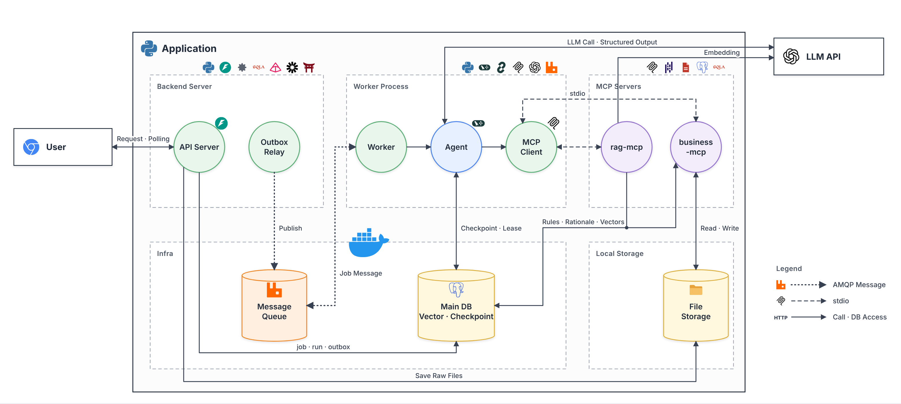

API는 작업을 접수만 하고, 분석은 Worker가 비동기로 수행한다. 작업 상태와 발행할 메시지를 같은 트랜잭션에 저장(Outbox)한 뒤 RabbitMQ로 넘기므로, 웹 요청이 모델 응답을 기다리지 않는다. Worker는 LangGraph로 분석을 실행하고, 계산과 지식 검색은 두 MCP 서버에 맡긴다.

| 서비스       | 역할                                                       | 외부 포트     |
| ------------ | ---------------------------------------------------------- | ------------- |
| api          | FastAPI, 웹 화면, 로그인, Outbox 발행                      | 8000          |
| worker       | 큐 소비, LangGraph 실행, MCP 연결 (여러 개로 늘릴 수 있다) | —             |
| business-mcp | 데이터 조회, 집계·비교, 분석, 규칙·결과물 저장             | — (내부 8001) |
| rag-mcp      | 업무 규정·확인된 지식 검색과 등록                          | — (내부 8002) |
| postgres     | 업무 데이터, LangGraph 체크포인트, pgvector 색인           | 5433          |
| rabbitmq     | 작업 큐, 지연 재시도 큐(10·30·60초), 실패 큐               | 5672 / 15672  |

- **인증:** 사용자는 JWT로 로그인하고, 모든 자원은 회사(tenant) 단위로 격리된다. 다른 회사의 데이터는 존재 여부도 알리지 않는다. Worker는 MCP 서버를 부를 때마다 회사·실행 범위를 서명한 실행 토큰을 보낸다.
- **신뢰성:** 같은 메시지가 다시 와도 처리 기록으로 무시하고, 실행 lease로 같은 작업의 동시 실행을 막는다. 일시 장애는 체크포인트부터 이어서 재시도한다.
- 품질 요구는 ISO/IEC 25010 특성별로 정리했다 → [품질 검증 결과](docs/05_품질검증결과.md)

**기술 스택:** Python 3.12 · FastAPI · LangGraph · LangChain(OpenAI `gpt-4o-mini`) · MCP SDK(Streamable HTTP) · PostgreSQL + pgvector · RabbitMQ · pandas · pdfplumber · LangSmith · Docker Compose

## 3. AI Agent와 MCP

### Agent: LangGraph (State 27개 필드 · Node 12개 · Edge 18개)

<p align="center">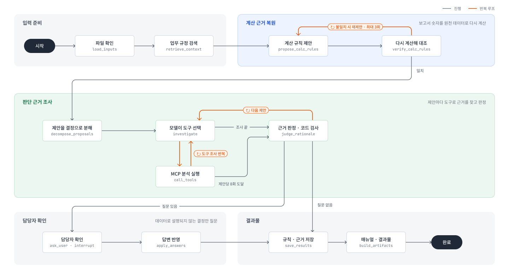</p>

<details>
<summary><b>State 명세</b> (27개 필드)</summary>

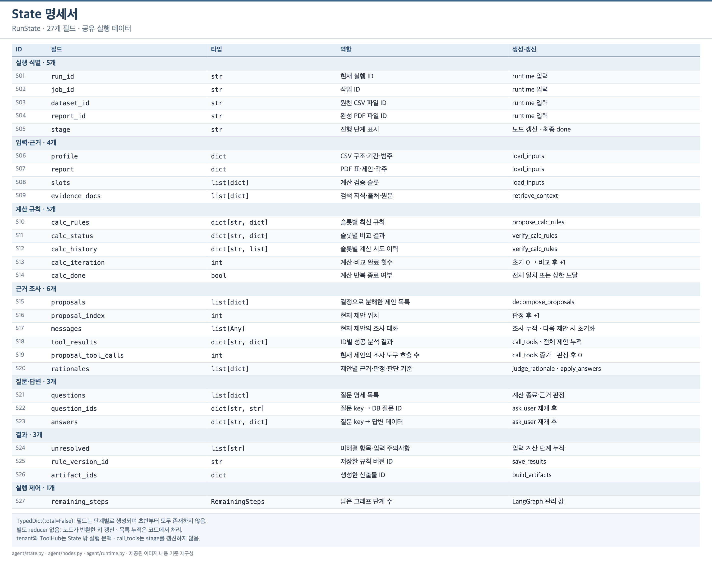

</details>

<details>
<summary><b>Node 명세</b> (12개)</summary>

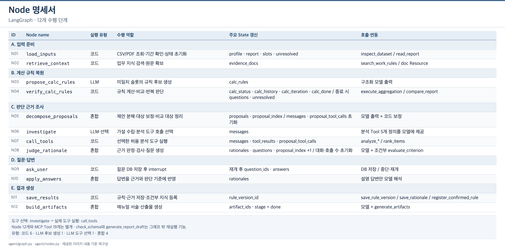

</details>

<details>
<summary><b>Edge와 실행 흐름</b> (18개)</summary>

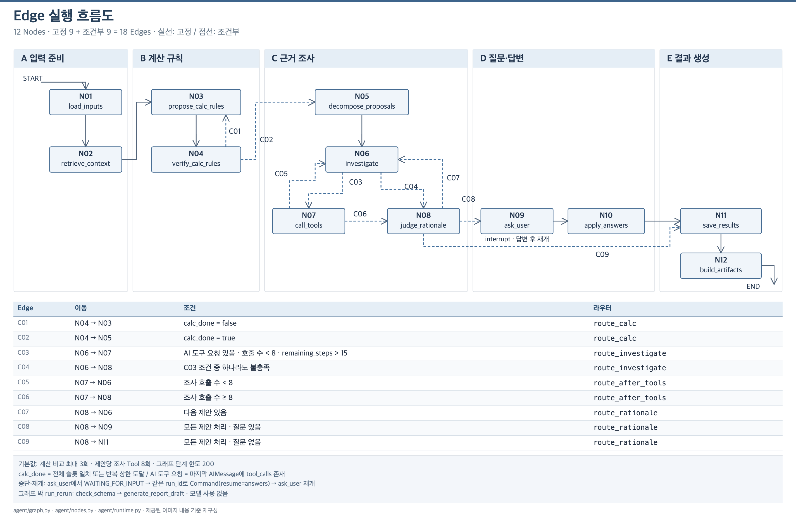

</details>

모델이 하는 일은 계산 규칙 후보 제안, 분석 도구 선택, 근거 판정이다. 실제 계산, 권한 확인, 결과 검증, 저장은 코드와 MCP 서버가 맡는다. 반복은 세 곳에 있다. 계산이 보고서와 다르면 규칙을 다시 제안하고, 제안마다 도구 조사를 반복하고, 근거가 부족하면 담당자 질문에서 멈췄다가(`interrupt`) 답변이 오면 같은 실행을 재개한다.

### MCP: 업무 기능을 서버 2개로 분리

| 서버         | 도구               | 하는 일                                                                                                    |
| ------------ | ------------------ | ---------------------------------------------------------------------------------------------------------- |
| business-mcp | 15개               | 데이터·보고서 조회, 집계·비교, 분석 5종(추세·기준선·행사·요일·순위), 규칙·근거·결과물 저장, 다음 기간 초안 |
| rag-mcp      | 4개 + Resource 2종 | 업무 규정 검색, 원문 조회(`doc://`), 지식 목록(`knowledge://`), 확인된 지식 등록                           |

같은 서버 코드를 배포에서는 Streamable HTTP로, 로컬 개발에서는 stdio로 연결한다. 모델에게는 조사 단계의 분석 도구 5개만 보여 주고, 저장 도구는 정해진 코드 단계에서만 호출한다.

<details>
<summary><b>MCP 도구 전체 목록</b> (Tool 19개 · Resource 2종)</summary>

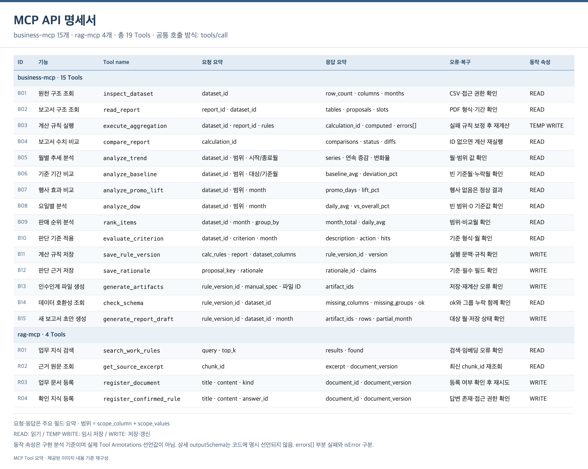

</details>

자세한 흐름 → [실행 흐름](docs/03_실행흐름.md) · 핵심 개념 → [판단 근거 추론](docs/02_핵심개념.md)

## 4. Harness와 품질 검증

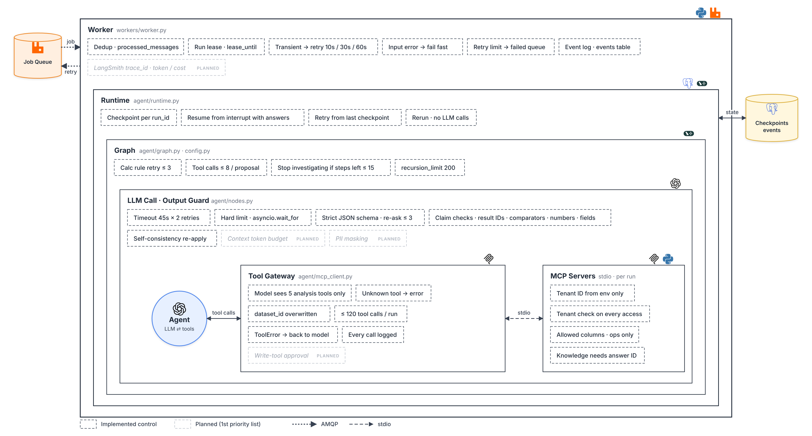

하네스는 모델 바깥에서 모델을 돌리고, 감시하고, 막는 코드다. 프롬프트로 "하지 마"라고 지시하는 대신 코드로 강제한다.

| 구성 요소                  | 하는 일                                                                                               |
| -------------------------- | ----------------------------------------------------------------------------------------------------- |
| 반복 제어                  | 계산 재시도 3회, 제안당 도구 8회, 시도당 도구 120회, 실행시간 한도                                    |
| 도구 허용 목록 · 변경 승인 | 목록 밖 도구 차단, 저장 도구는 정해진 단계에서만, 확정 지식 등록은 담당자 답변이 있어야 실행          |
| 개인정보 마스킹            | 이메일·전화·주민번호·카드번호·이름을 모델 입력, LangSmith, 로그에서 가림                              |
| 컨텍스트 예산              | 도구 결과 길이 제한, 호출당·시도당 토큰 예산. 넘으면 조사를 줄이고 끝까지 완료                        |
| 출력 검증                  | 스키마 검증 후 재요청, 인용한 결과 ID와 숫자가 실제로 있는지 검사                                     |
| 사람 개입 · 상태 저장      | 근거 없는 결정은 질문, Postgres 체크포인트에서 재개                                                   |
| 관측 · 장애 복구           | trace_id 하나로 이벤트·MCP 로그·LangSmith 연결, 모델 호출마다 토큰·비용 기록, 일시 장애는 지연 재시도 |

**품질 검증:** 「품질목표 및 검증 기준서」의 지표 18개를 자동화 테스트로 측정해 모두 통과했다. 모델 API 429·503, 실제 MCP 컨테이너 중지, RabbitMQ 재시작 같은 장애 42회에서 모두 자동 복구했고, 비인가 요청 125건을 모두 차단했다.

→ [품질 검증 결과](docs/05_품질검증결과.md) · [평가표 항목별 구현 위치](docs/04_평가표_구현위치.md)

## 5. 실행 화면

### 로그인

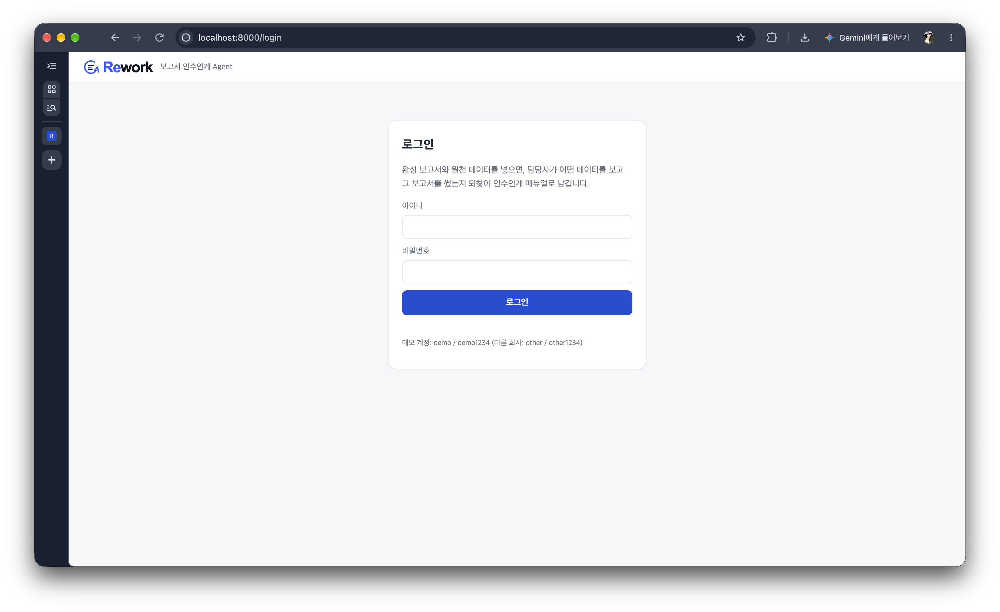

- 사용자는 JWT로 로그인하고, 모든 작업·파일·결과물은 **회사 단위로 격리**된다. 다른 회사의 데이터는 존재 여부도 보이지 않는다.

### 대시보드: 업로드와 업무 지식

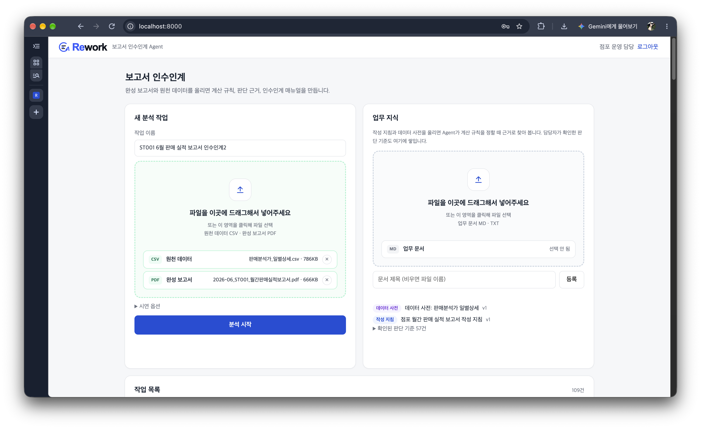

- 원천 CSV와 완성 보고서 PDF를 **한 번에 끌어다 놓으면 확장자로 자동 배정**된다. 사용자가 할 일은 파일 두 개를 올리는 것뿐이다.
- 오른쪽 **업무 지식**에 작성 지침과 데이터 사전을 올리면 Agent가 계산 규칙을 정할 때 근거로 검색한다(RAG).
- 담당자가 답한 판단 기준은 **"확인된 판단 기준"으로 쌓여** 다음 분석에서 다시 쓰인다. 인수인계가 일회성 문서가 아니라 조직의 지식으로 축적된다.

### 진행 화면: 무엇을 하고 있는지 그대로 보인다

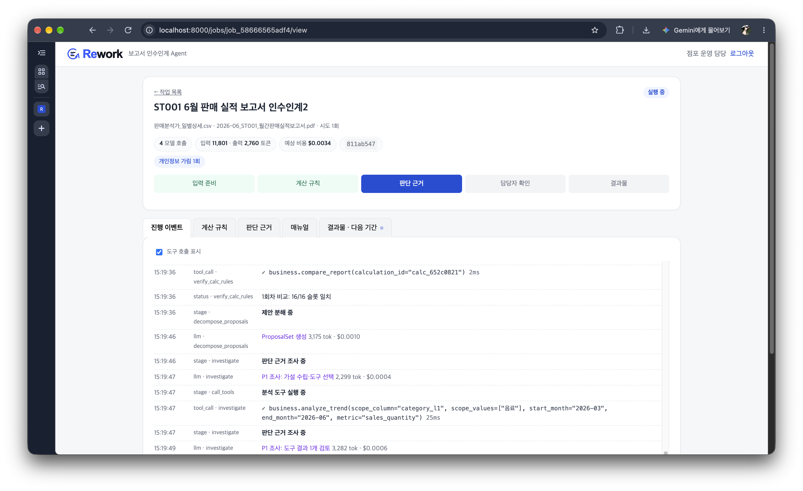

- 5단계(입력 준비 → 계산 규칙 → 판단 근거 → 담당자 확인 → 결과물)로 현재 위치를 보여 준다.
- 진행 이벤트에 **모델이 고른 도구와 인자, 소요 시간**이 그대로 찍힌다. "1회차 비교: 16/16 슬롯 일치"처럼 계산 검증 결과도 바로 보인다.
- 상단에 **모델 호출 수, 입력·출력 토큰, 예상 비용, trace_id**를 실시간으로 표시하고, 개인정보를 가린 횟수 같은 하네스 동작도 함께 보여 준다.

### 담당자 확인: 꼭 필요한 것만 묻는다

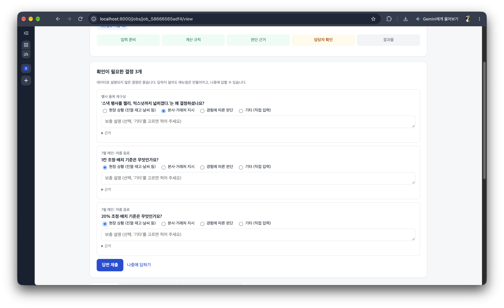

- 데이터로 설명된 결정은 묻지 않는다. **데이터로 설명되지 않는 결정만, 한 번에 최대 3개** 묻는다.
- 서술형이 아니라 **객관식**(현장 상황 / 본사·거래처 지시 / 경험에 따른 판단 / 기타)이라 담당자가 몇 번의 클릭으로 답할 수 있다.
- "근거"를 펼치면 Agent가 왜 이 질문을 했는지 데이터를 볼 수 있다. 지금 답하기 어려우면 **"나중에 답하기"**로 넘기고, 완료 후에 답해도 매뉴얼이 갱신된다.

### 결과물

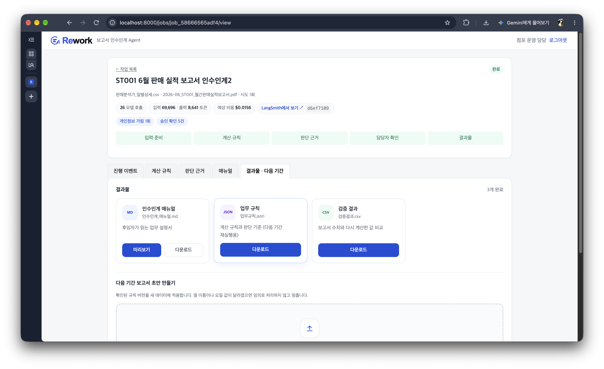

- **인수인계 매뉴얼, 업무 규칙(JSON), 검증 결과(CSV)** 세 가지가 만들어진다. 매뉴얼은 화면에서 바로 미리 볼 수 있다.
- "승인 확인 5건"은 업무 지식 등록 5건이 모두 **담당자 답변 ID를 확인한 뒤** 진행됐다는 뜻이다. 답변 없는 추론은 업무 지식으로 등록되지 않는다.
- 아래 **다음 기간 보고서 초안 만들기**에 새 달의 CSV를 올리면, 저장된 규칙으로 모델 호출 없이 보고서 초안을 만든다.

### 인수인계 매뉴얼

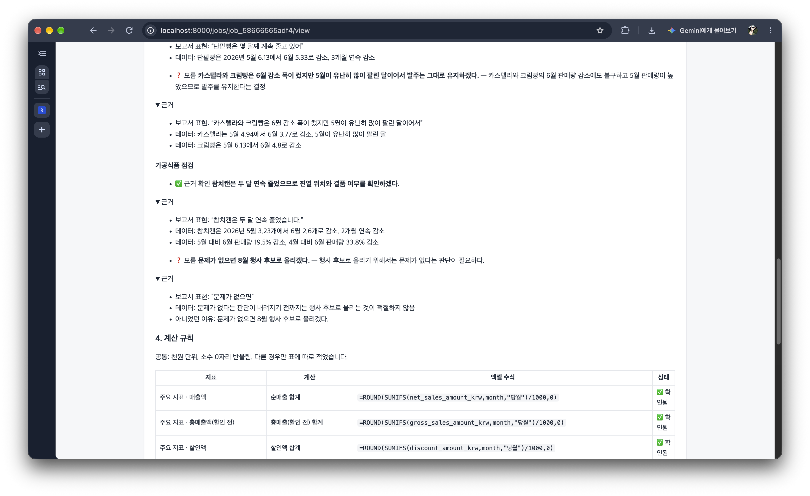

- 결정마다 **✅ 근거 확인 / ❓ 모름** 같은 라벨이 붙어, 후임자가 어디까지 믿고 어디를 다시 확인해야 하는지 알 수 있다.
- "근거"를 펼치면 **보고서 원문 표현과 그것을 뒷받침하는 실제 데이터**가 나란히 나온다. 예: "참치캔은 두 달 연속 줄었습니다" ↔ 5월 3.23개 → 6월 2.6개, 2개월 연속 감소
- 계산 규칙은 지표마다 업무 언어 설명과 **엑셀 수식**으로 정리돼, 개발 지식 없이도 같은 숫자를 다시 만들 수 있다.

### LangSmith 추적

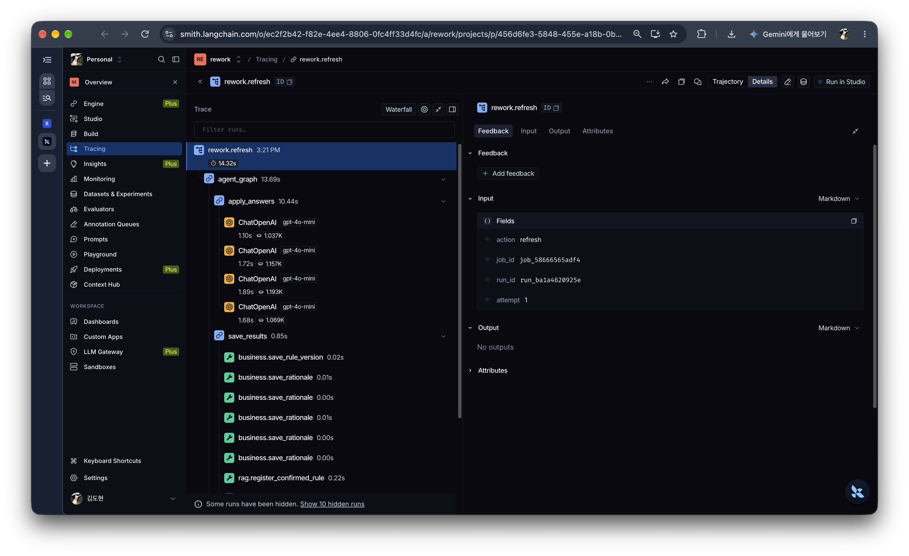

- 작업 화면의 "LangSmith에서 보기"를 누르면 실행 한 번이 **하나의 trace 트리**로 열린다.
- LangGraph 노드, 모델 호출(`gpt-4o-mini`, 소요 시간·토큰), MCP 도구 호출(`business.save_rule_version`, `rag.register_confirmed_rule` 등)이 같은 trace_id 아래 연결된다.
- 진행 이벤트, MCP 서버 로그, LangSmith가 같은 trace_id를 쓰므로 어느 한 곳에서 문제를 찾으면 나머지를 바로 따라갈 수 있다.

## 6. 실행 방법

준비: Docker Desktop 실행, 루트 `.env`에 OpenAI 키 (`OPENAI_API_KEY`, 또는 `OPEN_API_KEY`). 설정 예시는 `.env.example`에 있다. LangSmith 추적은 선택이다.

### 시연 계정과 데이터

`seed_demo.py`가 아래 테스트 계정과 업무 규정을 등록한다. 업로드할 파일은 저장소의 `data/` 폴더에 있다.

| 구분 | 값 |
|---|---|
| 테스트 계정 | `demo` / `demo1234` (ST001 점포 운영팀) |
| 다른 회사 계정 | `other` / `other1234` (회사 격리 확인용: demo의 작업·파일이 보이지 않는다) |
| 원천 데이터 (CSV) | [`data/판매분석가_일별상세.csv`](data/판매분석가_일별상세.csv) |
| 완성 보고서 (PDF) | [`data/2026-06_ST001_월간판매실적보고서.pdf`](data/2026-06_ST001_월간판매실적보고서.pdf) |
| 다음 기간 재실행 | 같은 CSV + 기간 `2026-07` |

### A. 전체를 컨테이너로 실행 (기본)

api · worker · business-mcp · rag-mcp · PostgreSQL · RabbitMQ가 함께 뜬다. Worker는 두 MCP 서버에 **Streamable HTTP**로 연결하고, 요청마다 서명한 실행 토큰을 보낸다.

```bash
docker compose up -d --build
docker compose exec api python scripts/seed_demo.py   # 처음 한 번: 데모 회사·사용자·업무 지식 등록
```

### B. 로컬 개발 (MCP를 stdio로 연결)

같은 MCP 서버 코드를 Worker가 실행마다 자식 프로세스로 띄운다.

```bash
uv sync                                   # 의존성 설치 (버전은 uv.lock에 고정)
docker compose up -d postgres rabbitmq    # PostgreSQL(5433) + RabbitMQ(5672, 관리 화면 15672)
uv run python scripts/seed_demo.py

# 터미널 1: API + 화면
uv run uvicorn rework.api.main:app --port 8000
# 터미널 2: Worker
uv run python -m rework.workers.worker
```

A와 B를 동시에 실행하지 않는다 (두 Worker가 같은 큐를 나눠 가진다). 업로드 파일은 두 방식 모두 `var/storage`에 저장된다.

### 사용해 보기

1. http://localhost:8000 에서 `demo` / `demo1234`로 로그인한다.
2. 대시보드의 점선 영역에 `data/`의 CSV와 PDF를 한 번에 끌어다 놓고 **분석 시작**을 누른다. 확장자로 원천 데이터와 보고서 칸에 자동으로 들어간다. "장애 시연"을 켜면 첫 도구 호출이 실패하고 10초 뒤 큐 재시도로 이어서 진행된다.
3. 작업 화면에서 진행 이벤트, 토큰·비용, LangSmith 링크를 본다. 약 1~2분 뒤 **담당자 확인 질문**이 뜨면 답하거나 "나중에 답하기"를 누른다.
4. 완료되면 계산 규칙·판단 근거·매뉴얼 탭과 결과물을 확인한다.
5. "결과물 · 다음 기간" 탭에서 같은 CSV와 `2026-07`을 넣으면 7월(부분월) 보고서 초안이 만들어진다.

### HTTP API

<details>
<summary><b>HTTP API 전체 목록</b></summary>

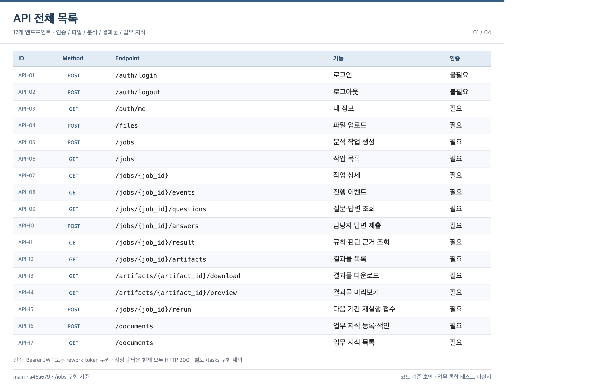

</details>

### 개발용 명령

```bash
uv run pytest                                     # 단위 + API 통합 테스트 (통합 테스트는 DB 필요)
uv run python scripts/run_local.py --auto-answer  # 큐·API 없이 Agent만 실행 (질문에 자동 응답)
uv run python scripts/eval_run.py <job_id>        # 정답표와 비교
```

`tests/`는 모델을 부르지 않는다. `run_local.py`, `eval_run.py`, 화면 실행, `scripts/quality/`의 품질 측정은 실제 OpenAI 모델을 부른다. 품질 측정을 다시 하는 방법은 [품질 검증 결과 7장](docs/05_품질검증결과.md#7-재현-방법)에 있다.

### 폴더

```text
src/rework/
├── api/            FastAPI (인증·파일·작업·질문·결과·화면)
├── auth/           JWT·비밀번호·MCP 실행 토큰
├── queue/          RabbitMQ 큐 구성·outbox 발행기
├── workers/        Worker (중복 방지·lease·재시도·실행시간 한도)
├── agent/          LangGraph 그래프·노드·프롬프트·MCP 클라이언트·승인 정책·컨텍스트 예산
├── business_mcp/   MCP 서버 + 서비스 (데이터·PDF 파서·계산·분석·결과물)
├── rag_mcp/        MCP 서버 + 색인·검색
├── contracts/      규칙·판단 기준 스키마, 설명 문구
├── db/             SQLAlchemy 모델·세션
├── web/            템플릿·CSS·JS
├── privacy.py      개인정보 마스킹
└── observability.py  trace_id·LangSmith·토큰 비용
data/               원천 데이터 CSV · 완성 보고서 PDF (Agent 입력)
docs/               문서, 이미지(images/), 품질 측정 증빙(quality/)
docs/knowledge/     시연용 업무 지침 (RAG 시드 데이터)
tests/fixtures/ground_truth/   정답표·보고서 원본 HTML (Agent 입력 아님)
scripts/            시드·로컬 실행·평가, quality/ 품질 측정
var/                업로드·결과물 저장소 (Git 제외)
```

## 7. 문서

| 문서                                              | 내용                                                                                         |
| ------------------------------------------------- | -------------------------------------------------------------------------------------------- |
| [01 기획서](docs/01_기획서.md)                    | 배경과 문제, 해결 방안, 이해관계자, 비즈니스 가치, 서비스 범위 |
| [02 핵심 개념](docs/02_핵심개념.md)               | 계산 규칙 복원과 판단 근거 추론의 원리                                                       |
| [03 실행 흐름](docs/03_실행흐름.md)               | 노드별 동작, 구성 요소, MCP 도구 설명                                                        |
| [04 평가표 구현 위치](docs/04_평가표_구현위치.md) | 평가 항목마다 코드 위치와 근거, Harness 상세                                                 |
| [05 품질 검증 결과](docs/05_품질검증결과.md)      | ISO/IEC 25010 기반 18개 지표 측정 결과, 측정 환경과 재현 방법 |
