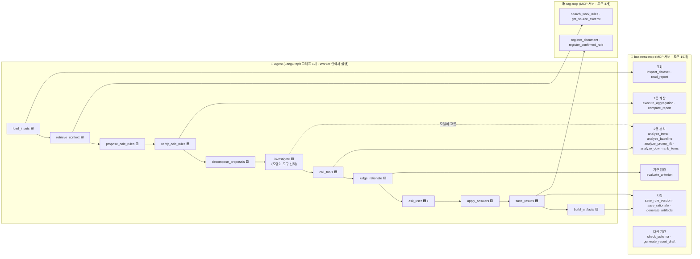
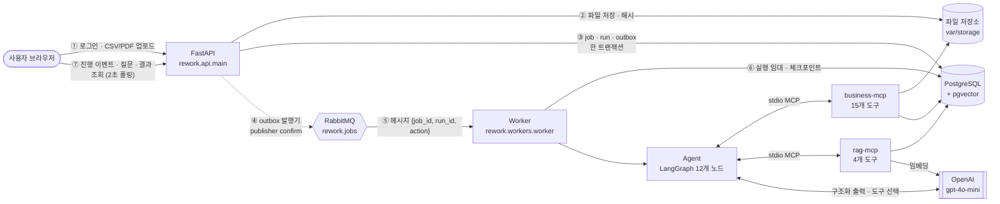
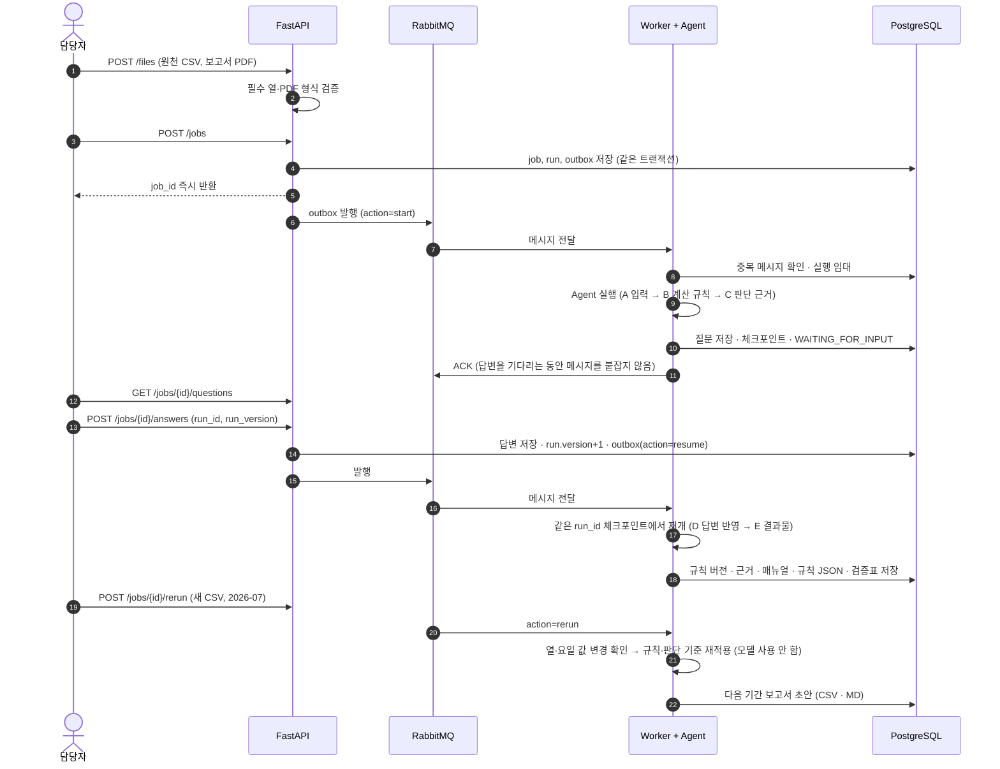
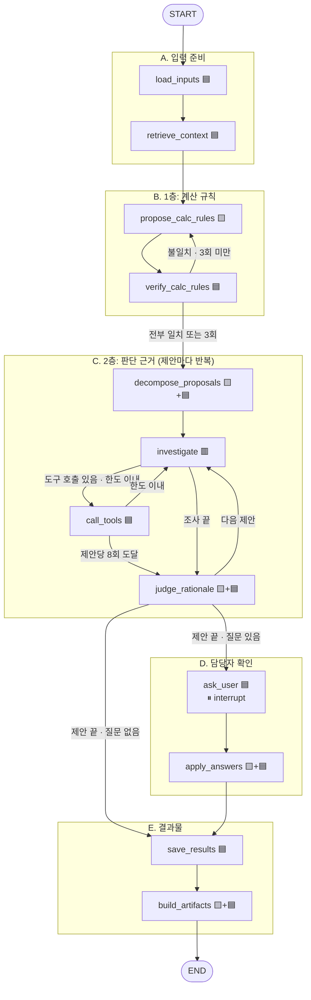
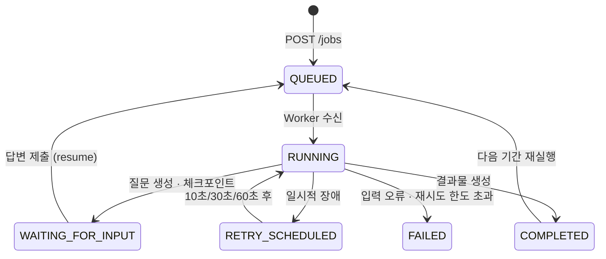

# Re:Work 실행 흐름과 구성 요소

이 문서는 완성된 구현물을 처음 보는 사람이 **무엇이, 어떤 순서로, 어디서 실행되는지** 파악할 수 있도록 정리한 것이다.
개념 설명은 `핵심개념_판단근거추론.md`, 실행 방법은 `README.md`를 본다.

---

## 0. 먼저 보는 법: Agent와 MCP의 구분

| 구분 | 무엇인가 | 개수 | 비유 |
|---|---|---|---|
| **Agent** | LangGraph 그래프 **1개**. 무엇을 어떤 순서로 할지, 다음에 어디로 갈지를 정한다. Worker 안에서 실행된다. | 1개 (노드 12개) | 머리 · 작업 순서 |
| **MCP 서버** | Agent가 부르는 **도구 묶음**. 계산·조회·저장을 실제로 한다. 별도 프로세스로 뜬다. | 2개 (business-mcp, rag-mcp) | 손 · 계산기와 서류함 |

- **노드** = Agent 안의 한 단계 (예: `verify_calc_rules`). 노드 이름은 소문자_밑줄로 쓴다.
- **도구** = MCP 서버가 제공하는 기능 (예: `execute_aggregation`). 노드가 도구를 부른다.
- 🟦🟨🟥 색은 **Agent 노드 안에서 누가 결정하는지**를 나타낸다. MCP와 Agent를 가르는 표시가 아니다.
  - 🟦 코드: 정해진 순서대로 도구를 부른다 (모델 없음)
  - 🟨 LLM: 모델이 글이나 구조(JSON)를 만든다. 도구는 부르지 않는다
  - 🟥 LLM + 도구 선택: 모델이 **어떤 MCP 도구를 부를지 직접 고른다** (`investigate` 하나뿐)

화살표는 "이 노드가 이 도구를 부른다"는 뜻이다. `propose_calc_rules`, `decompose_proposals`, `apply_answers`처럼 화살표가 없는 노드는 모델만 쓰고 도구는 부르지 않는다. `check_schema`·`generate_report_draft`는 그래프 밖의 재실행 흐름(`run_rerun`)에서 쓴다.

---

## 1. 전체 시스템 흐름

- 파일은 큐로 보내지 않는다. 큐에는 ID만 들어가고, Worker와 MCP 서버가 DB에서 파일 위치를 찾는다.
- Agent는 별도 서버가 아니다. Worker 프로세스 안에서 Python 패키지로 실행된다.
- MCP 서버 두 개는 Worker가 실행마다 stdio 하위 프로세스로 띄운다. 회사·실행 ID는 환경 변수로 넘기며, **모델이 보내는 인자로는 권한을 정하지 않는다.**

---

## 2. 사용자 관점 시퀀스 (분석 → 질문 → 재개 → 다음 기간)

---

## 3. Agent 그래프 (LangGraph)

🟦 코드 · 🟨 LLM 구조화 출력(OpenAI strict json_schema) · 🟥 LLM이 MCP 도구를 직접 선택

---

## 4. 이름별 역할

### 4.1 실행 구성 요소

| 이름 | 위치 | 실행 방식 | 하는 일 |
|---|---|---|---|
| **FastAPI** | `src/rework/api/main.py` | `uvicorn rework.api.main:app` | 로그인(JWT 쿠키), 파일 업로드·검증, 작업 생성, 진행 이벤트·질문·결과 조회, 답변 제출, 다음 기간 재실행 등록, 화면 제공. 시작할 때 outbox 발행기를 백그라운드로 띄운다. |
| **outbox 발행기** | `src/rework/queue/rabbit.py` `outbox_relay` | API 프로세스 안 백그라운드 작업 | DB `outbox` 테이블의 미발행 이벤트를 1초마다 RabbitMQ로 옮기고, 브로커 확인 후 발행 완료로 표시한다. 큐가 내려가 있어도 이벤트가 DB에 남아 있다가 나중에 발행된다. |
| **RabbitMQ** | `compose.yaml` | Docker | `rework.jobs`(작업), `rework.retry.10s/30s/60s`(TTL 지연 큐, 만료되면 jobs로 되돌아옴), `rework.failed`(재시도 한도 초과) |
| **Worker** | `src/rework/workers/worker.py` | `python -m rework.workers.worker` | 큐 메시지 소비 → 중복 확인 → 실행 임대 → Agent 실행 → 상태 저장 후 ACK. 일시적 장애는 지연 큐로 재시도하고, 입력 오류는 바로 실패 처리한다. |
| **Agent Runtime** | `src/rework/agent/runtime.py` | Worker 안에서 호출 | `run_analysis`: 시작·체크포인트 이어 실행·답변 재개를 구분해 그래프를 돌린다. `run_rerun`: 모델 없이 규칙 버전을 새 데이터에 적용한다. |
| **ToolHub (MCP 클라이언트)** | `src/rework/agent/mcp_client.py` | Agent 실행마다 생성 | 두 MCP 서버를 stdio로 띄우고 도구 목록을 발견한다. 모든 도구 호출을 세고(실행당 120회 한도) 이벤트로 기록한다. 장애 시연 옵션이면 첫 호출을 일시적 실패로 만든다. |
| **business-mcp** | `src/rework/business_mcp/server.py` | MCP 서버 (stdio) | 데이터 조회, 허용된 연산만으로 계산·분석, 규칙·근거·결과물 저장 |
| **rag-mcp** | `src/rework/rag_mcp/server.py` | MCP 서버 (stdio) | 업무 지침·데이터 사전·확인된 답변 검색, 확인된 규칙 등록 |
| **PostgreSQL + pgvector** | `compose.yaml` | Docker (포트 5433) | 업무 데이터, LangGraph 체크포인트, RAG 임베딩 |
| **화면** | `src/rework/web/` | FastAPI 템플릿 + 순수 JS | 로그인, 대시보드(작업 생성·지식 등록·목록), 작업 상세(단계 표시·이벤트·질문·계산 규칙·판단 근거·매뉴얼·다음 기간) |

### 4.2 Agent 노드 (12개)

| 단계 | 노드 | 종류 | 하는 일 | 부르는 도구 | State에 쓰는 것 |
|---|---|---|---|---|---|
| A | `load_inputs` | 🟦 | 원천 CSV 구조와 보고서 PDF를 구조화한다. 보고서 기간의 데이터가 없으면 입력 오류로 멈춘다. | `inspect_dataset`, `read_report` | `profile`, `report`, `slots`(검증할 지표 16개) |
| A | `retrieve_context` | 🟦 | 매출 정의·표기 단위 등을 업무 지식에서 검색한다. 결과가 없으면 "관련 규정 없음"으로 진행한다. | rag `search_work_rules` | `evidence_docs` |
| B | `propose_calc_rules` | 🟨 | 아직 맞지 않은 슬롯마다 계산 규칙(열·연산·단위·반올림)을 제안한다. 이전 시도의 차이를 보고 고친다. | 없음 | `calc_rules` |
| B | `verify_calc_rules` | 🟦 | 규칙을 실제로 계산해 보고서 값과 칸별로 비교한다. 끝나면 계산 규칙 일괄 확인 질문을 만든다. | `execute_aggregation`, `compare_report` | `calc_status`, `calc_history`, `calc_iteration` |
| C | `decompose_proposals` | 🟨+🟦 | 모델이 제안 문장을 결정(claim)으로 나눈다. 코드가 이름을 데이터 값으로 맞추고, 같은 결정은 묶고, **반대 결정을 받은 대상을 비교 대상으로 붙인다.** | 없음 | `proposals` |
| C | `investigate` | 🟥 | 모델이 근거 가설을 세우고 분석 도구를 직접 고른다. 대상과 비교 대상을 함께 비교한다. | (모델이 선택) | `messages` |
| C | `call_tools` | 🟦 | 모델이 고른 도구를 실행한다. `dataset_id`는 신뢰된 값으로 덮어쓰고, 결과마다 `r1, r2…` ID를 붙인다. 제안당 8회 한도. | `analyze_*`, `rank_items` | `tool_results`, `proposal_tool_calls` |
| C | `judge_rationale` | 🟨+🟦 | 모델이 결정마다 근거를 판정하고 판단 기준으로 일반화한다. 코드가 ① 결과 ID 존재 ② 비교 대상 판별 ③ 인용 숫자의 근거 ④ 기준 필드 ⑤ **기준을 당월에 다시 적용한 자기 일관성**을 검사한다. | `evaluate_criterion` | `rationales`, `questions` |
| D | `ask_user` | 🟦 | 질문을 DB에 저장하고 `interrupt`로 멈춘다. 답변이 오면 같은 `run_id` 체크포인트에서 여기부터 재개한다. | 없음 | `question_ids`, `answers` |
| D | `apply_answers` | 🟨+🟦 | 답변을 근거에 반영한다. 자유 입력 답변은 모델이 판단 기준 문장으로 정리한다. 확인 상태는 저장 시점에 DB 답변 기록으로만 정해진다. | 없음 | `rationales` |
| E | `save_results` | 🟦 | 규칙 버전과 근거를 저장하고, **담당자가 확인한 지식만** rag에 등록한다. | `save_rule_version`, `save_rationale`, rag `register_confirmed_rule` | `rule_version_id` |
| E | `build_artifacts` | 🟨+🟦 | 모델은 매뉴얼의 서술만 쓰고, 표·숫자는 business-mcp가 저장된 규칙을 다시 실행해 채운다. | `generate_artifacts` | `artifact_ids` |

### 4.3 business-mcp 도구 (15개)

| 분류 | 도구 | 입력 | 반환 · 하는 일 | 쓰는 곳 |
|---|---|---|---|---|
| 조회 | `inspect_dataset` | dataset_id | 열·타입·결측치·월별 영업일수(부분월 표시)·범주형 값 목록 | load_inputs |
| 조회 | `read_report` | report_id, dataset_id | PDF의 표·제안·각주와 검증 슬롯. 머리글 칸의 x 범위와 행 구분선으로 표를 복원한다. | load_inputs |
| 1층 계산 | `execute_aggregation` | dataset_id, report_id, rules | 규칙을 실제 계산해 calculation_id 반환. 허용 열·연산만 실행한다. | verify_calc_rules |
| 1층 계산 | `compare_report` | calculation_id | 슬롯별 일치 칸 수, matched/mismatched, 차이 예시 | verify_calc_rules |
| 2층 분석 | `analyze_trend` | 범위, 시작·끝 월, 지표 | 월별 일평균 추세, 연속 증가·감소 개월 수, 변화율 | investigate |
| 2층 분석 | `analyze_baseline` | 범위, 대상 월, 기준 월들 | 평소 수준 대비 이탈률(deviation_pct) | investigate |
| 2층 분석 | `analyze_promo_lift` | 범위, 월 | 행사일과 비행사일의 일평균 비교(lift_pct) | investigate |
| 2층 분석 | `analyze_dow` | 범위, 월 | 요일별 일평균과 월 평균 대비 차이 | investigate |
| 2층 분석 | `rank_items` | 월, 지표, 비교월 | 순위와 비교월 대비 증감률 | investigate |
| 2층 검증 | `evaluate_criterion` | dataset_id, 판단 기준, 월 | 기준을 실제 데이터에 적용해 걸리는 대상 반환 | judge_rationale, 다음 기간 초안 |
| 저장 | `save_rule_version` | 계산 규칙·검증 상태·확인 참조 | 새 규칙 버전 저장. 확인 상태는 질문 ID에 연결된 실제 답변으로만 정한다. | save_results |
| 저장 | `save_rationale` | 제안 키, 근거 | 결정별 근거·기준·확인 상태 저장 (같은 실행에서는 덮어씀) | save_results |
| 저장 | `generate_artifacts` | 규칙 버전, 매뉴얼 서술 | 인수인계 매뉴얼.md, 업무규칙.json, 검증결과.csv 생성 | build_artifacts |
| 재실행 | `check_schema` | 규칙 버전, 새 데이터 | 빠진 열, 처음 보는 요일 값, 사라진 품목·카테고리 | run_rerun |
| 재실행 | `generate_report_draft` | 규칙 버전, 새 데이터, 월 | 다음 기간 보고서 초안(CSV·MD)과 판단 기준 적용 결과(제안 후보) | run_rerun |

오류 처리: 예상한 오류(없는 품목명, 없는 월, 허용되지 않은 열, 접근 권한 없음)는 `ToolError` 메시지로 돌려준다. 조사 단계에서는 이 메시지를 모델에게 그대로 전달해 스스로 고치게 하고, 그 밖의 단계에서는 입력 오류로 처리한다.

### 4.4 rag-mcp 도구 (4개)

| 도구 | 하는 일 | 반환 필드 |
|---|---|---|
| `search_work_rules` | 회사별 업무 지식 검색. 유사도 0.30 미만은 버리고, 결과가 없으면 빈 목록 | document_id, document_version, chunk_id, title, excerpt, source_location |
| `get_source_excerpt` | 문서 조각 원문과 버전 조회 | 위와 같음 (excerpt 전체) |
| `register_document` | 업무 문서를 제목 단위로 나눠 색인. 같은 제목이면 새 버전 | document_id, document_version, chunks |
| `register_confirmed_rule` | 담당자가 확인한 규칙을 다음 실행에서 검색되게 등록. **답변 ID가 없으면 등록 거부** | document_id, document_version |

지식 종류: ① 보고서 작성 지침(`docs/knowledge/`) ② 데이터 사전(`data/컬럼명세서.csv`의 일별상세 열 설명, 계산식 제외) ③ 확인된 담당자 답변(실행 중에 쌓임)

### 4.5 Agent State 주요 필드

| 필드 | 내용 |
|---|---|
| `run_id`, `job_id`, `dataset_id`, `report_id` | Worker가 넣는 신뢰된 식별자. 회사 ID는 State에 두지 않고 실행 문맥(RunContext)에서만 쓴다. |
| `slots` | 보고서 표에서 뽑은 검증 대상 지표 (표·지표명·단위·그룹 기준·칸 값) |
| `calc_rules`, `calc_status`, `calc_history`, `calc_iteration` | 1층 규칙, 비교 결과, 시도 기록, 반복 횟수 |
| `proposals` | 제안별 결정(claim): 대상, 비교 대상, 결정 종류, 보고서에 적힌 근거 |
| `messages`, `tool_results`, `proposal_tool_calls` | 현재 제안의 조사 대화, 도구 결과(r1…), 제안당 호출 수 |
| `rationales` | 결정별 판정(explained · ambiguous · unexplained · user_explained), 판단 기준, 근거, 기각한 가설, 검사 메모 |
| `questions`, `question_ids`, `answers` | 질문 명세, DB 질문 ID, 답변 |
| `unresolved`, `rule_version_id`, `artifact_ids` | 미해결 항목, 저장된 규칙 버전, 결과물 |

### 4.6 작업 상태

| 장애 유형 | 처리 |
|---|---|
| 모델 API 시간 초과·연결 오류·속도 제한 | 일시적 장애 → 지연 큐 재시도 (마지막 체크포인트부터 이어서) |
| MCP 서버 연결 실패 | 일시적 장애 → 지연 큐 재시도 |
| 필수 CSV 열 누락, PDF 아님 | 업로드 시 400 오류 (작업을 만들지 않음) |
| 보고서 기간 데이터 없음, 새 데이터의 열·요일 값 변경 | 입력 오류 → FAILED, 변경 내용을 메시지로 표시 |
| 보고서와 숫자 불일치 | Agent가 규칙을 고쳐 다시 계산 (최대 3회), 그래도 안 되면 미해결로 기록 |
| 담당자 답변 필요 | 체크포인트 저장 후 대기, 큐 메시지는 ACK |
| 재시도 3회 초과 | `rework.failed` 큐로 이동, FAILED |
| 같은 메시지 중복 전달 | `processed_messages`로 무시 |
| 같은 실행 동시 처리 | `runs.lease_until` 임대로 막음 |
| 이미 처리된 질문·오래된 실행에 대한 답변 | 409 (재개 작업이 여러 번 생기지 않음) |

### 4.7 실행 한도

| 한도 | 값 | 위치 | 넘으면 |
|---|---|---|---|
| 1층 계산 규칙 재시도 | 3회 | `verify_calc_rules` → `route_calc` | 미해결로 기록하고 2층으로 진행 |
| 제안당 도구 호출 | 8회 | `call_tools` → `route_after_tools` | 지금까지 결과로 판정 |
| 실행당 도구 호출 | 120회 | `ToolHub.call` | 도구 오류 |
| 모델 호출 시간 | 45초 × (재시도 2회 + 1) + 10초 | `nodes._ainvoke` (`asyncio.wait_for`) | 일시적 장애 → 큐 재시도 |
| 구조화 출력 형식 오류 | 3회 재요청 | `nodes._structured` | 입력 오류 |
| 그래프 전체 단계 | 200 | LangGraph `recursion_limit` (안전망) | 실패 처리 |
| 남은 단계 확인 | 15단계 미만이면 조사 중단 | `RemainingSteps` → `route_investigate` | 판정으로 넘어감 |

### 4.8 DB 테이블

| 테이블 | 내용 |
|---|---|
| `tenants`, `users` | 회사, 사용자와 회사 소속 |
| `files` | 업로드 파일 정보·해시·보관 위치 |
| `jobs`, `runs` | 작업 상태·시도 횟수·오류, Agent 실행(분석·재실행)·버전·임대 |
| `questions`, `answers` | 담당자 질문(근거 포함)과 답변·답변자 |
| `rule_versions`, `rationales` | 구조화된 계산 규칙·확인 기록, 제안별 판단 근거 |
| `artifacts` | 매뉴얼·규칙 JSON·검증표·다음 기간 초안 |
| `documents`, `document_chunks` | 업무 지식 원본과 임베딩 조각 |
| `events` | 단계·도구 호출·모델 호출·재시도·오류 기록 (화면의 진행 이벤트) |
| `outbox`, `processed_messages` | 큐 발행 예정 이벤트, 처리한 메시지 ID |
| `checkpoints` 등 | LangGraph 체크포인트 (`AsyncPostgresSaver`가 관리) |

### 4.9 API

| 메서드 | 경로 | 하는 일 |
|---|---|---|
| POST | `/auth/login` · `/auth/logout` · GET `/auth/me` | 로그인(JWT, HttpOnly 쿠키 또는 Bearer), 로그아웃, 내 정보 |
| POST | `/files` | 업로드 (kind=source/report/document) · 형식·필수 열 검증 |
| POST · GET | `/jobs` | 작업 생성(outbox 등록) · 목록 |
| GET | `/jobs/{id}` · `/events?after=` · `/questions` · `/result` · `/artifacts` | 상태, 진행 이벤트, 질문, 규칙·근거, 결과물 |
| POST | `/jobs/{id}/answers` | 답변 제출 (run_id·run_version 검증 후 resume 등록) |
| POST | `/jobs/{id}/rerun` | 다음 기간 보고서 초안 생성 등록 |
| GET | `/artifacts/{id}/download` · `/preview` | 다운로드, Markdown 미리보기 |
| POST · GET | `/documents` | 업무 지식 등록 · 목록 |

다른 회사의 리소스는 존재 여부도 알리지 않고 404로 응답한다.

---

## 5. 검증 결과 (2026년 6월 보고서, gpt-4o-mini)

`scripts/eval_run.py`가 실행 결과를 정답표(`tests/fixtures/ground_truth/2026-06_answer_key.json`)와 비교한다. Agent는 정답표를 읽지 않는다.

| 항목 | 결과 | 비고 |
|---|---|---|
| 1층 계산 규칙: 보고서 수치 재현 | 16/16 슬롯 | 1~2회차 안에 모두 일치 |
| 1층 계산 규칙: 정답 규칙과 같은 열·연산 | 16/16 | |
| 2층 판단 근거: 기대한 분석 유형으로 기준을 세움 | 5/5 (최근 실행), 4/5 (이전 실행) | 모델 응답에 따라 실행마다 조금씩 다름 |
| 2층 판단 근거: 기대한 분석 도구를 호출함 | 5/5 | |
| 질문 수 | 6~9개 | 결정 묶기·제안별 확인 질문 적용 후 (적용 전 18개) |
| 큐 재시도 | 장애 시연 → 10초 후 재시도 → 체크포인트에서 이어서 완료 | API·Worker 통합 실행으로 확인 |
| 중복 답변 | 409로 거부 | |
| 다른 회사 접근 | 404로 거부 | `tests/integration/test_api.py` |

알려진 한계:
- 숫자가 도구 결과에 있는지는 코드가 검사하지만, **숫자 해석이 맞는지까지는 검사하지 못한다** (예: 감소를 '소폭 증가'로 쓴 경우). 담당자 확인 질문이 그 마지막 안전장치다.
- 같은 입력이라도 모델 응답에 따라 결정 분해와 기준값이 실행마다 조금씩 달라진다.
- 보고서 PDF 파서는 이 보고서 형식(머리글 테두리 + 행 구분선 표)에 맞춰져 있다.
